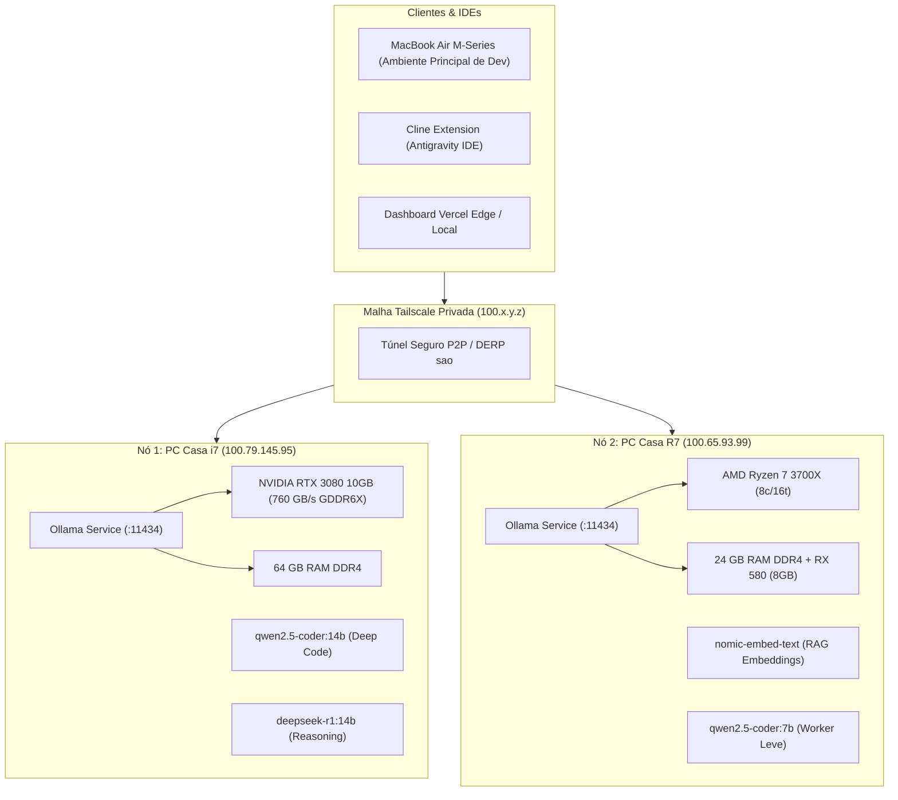

# 🏛️ Arquitetura do Cluster Antigravity AI Farm

## 1. Visão Geral da Topologia

O cluster unifica múltiplos computadores físicos locais via malha segura **Tailscale (WireGuard Mesh)**, expondo serviços locais de inferência com baixa latência (~40ms) e sem necessidade de abrir portas para a internet pública.

---

## 2. Métricas de Capacidade Combinada

- **Memória RAM de Sistema:** 88 GB (64 GB Nó 1 + 24 GB Nó 2).
- **Memória de Vídeo (VRAM):** 18 GB (10 GB RTX 3080 + 8 GB RX 580).
- **Processamento:** 16 Núcleos Físicos / 32 Threads (Intel i7 + AMD Ryzen 7 3700X).

---

## 3. Roteamento Inteligente de Tarefas (Task Specialization)

1. **Geração de Código Complexo & Refatoração:**
   - Destinado exclusivamente ao **Nó 1 (RTX 3080)**.
   - O modelo `qwen2.5-coder:14b` aloca ~7.26 GB na VRAM e 3 GB na RAM do sistema, mantendo geração estável em ~10 tokens por segundo.
2. **Geração de Embeddings & Busca Vetorial de Arquivos:**
   - Destinado ao **Nó 2 (Ryzen 7 3700X)**.
   - O modelo `nomic-embed-text` roda leve na CPU/RAM do Ryzen 7, permitindo indexar repositórios inteiros em milissegundos sem forçar a troca de modelo na GPU da RTX 3080.
